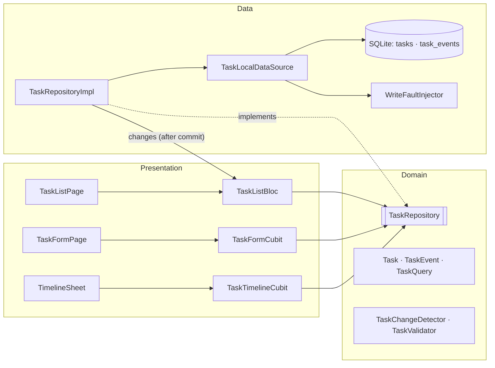
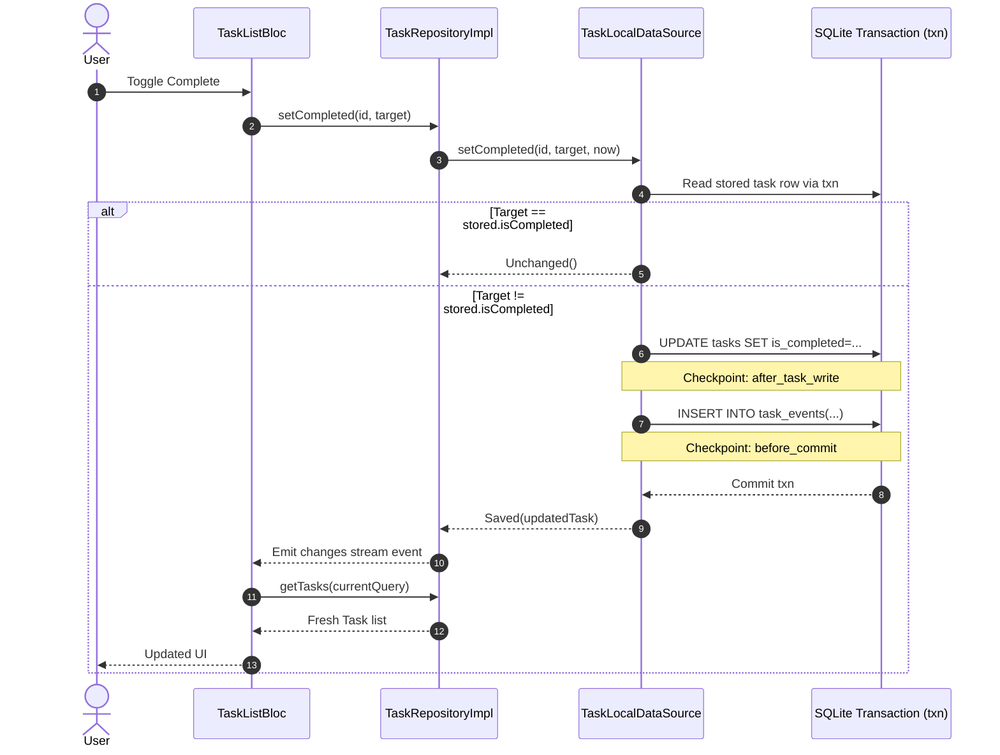

# DESIGN.md — Architecture, Atomicity & Engineering Decisions

Niksam is an offline-first Flutter task manager built with SQLite, BLoC, and strict transactional consistency. Every state mutation guarantees that task rows and audit timeline events are recorded atomically or completely rolled back on failure.

---

## 1. Architecture & Rejected Alternatives

The codebase follows a feature-first structure (`lib/features/tasks/{domain,data,presentation}`) alongside a lean `lib/core/`.

```
presentation → domain ← data
```

- **Domain is pure Dart**: Free from Flutter UI bindings, database drivers, or state management frameworks. Business logic resides in pure, deterministically testable functions (`TaskChangeDetector`, `TaskValidator`).
- **No UseCase classes (Rejected Alternative)**:
  *Rejected*: Clean Architecture with an isolated UseCase class per operation (e.g. `CreateTaskUseCase`, `DeleteTaskUseCase`).
  *Reason*: In a 2-screen offline app, each UseCase would simply be a 1-line pass-through forwarding calls to `TaskRepository`. BLoCs and Cubits depend directly on the `TaskRepository` interface, avoiding unnecessary ceremony while preserving complete testability and loose coupling.

### Architecture Diagram



---

## 2. Data Model & Atomicity

### Tables & Constraints

```sql
CREATE TABLE tasks(
  id TEXT PRIMARY KEY,
  title TEXT NOT NULL CHECK(length(trim(title)) > 0),
  description TEXT NOT NULL DEFAULT '',
  priority TEXT NOT NULL CHECK(priority IN ('low','medium','high')),
  is_completed INTEGER NOT NULL DEFAULT 0 CHECK(is_completed IN (0,1)),
  created_at INTEGER NOT NULL
);

CREATE TABLE task_events(
  id INTEGER PRIMARY KEY AUTOINCREMENT,
  task_id TEXT NOT NULL REFERENCES tasks(id) ON DELETE CASCADE,
  type TEXT NOT NULL CHECK(type IN ('created','priority_changed','completed','reopened')),
  from_priority TEXT,
  to_priority TEXT,
  occurred_at INTEGER NOT NULL
);

CREATE INDEX idx_events_task ON task_events(task_id, occurred_at, id);
CREATE INDEX idx_tasks_created ON tasks(created_at DESC);
```

### Design Rationale
- **TEXT Enums with CHECK constraints**: Rather than integer ordinals (which break when enum items reorder or expand), string literals (`'low'`, `'medium'`, `'high'`) ensure database readability and immutability.
- **UTC Milliseconds**: Epoch integers avoid timezone ambiguities and ISO-8601 string parsing overhead during sort and index scans.
- **`PRAGMA foreign_keys = ON`**: Configured inside SQLite `onConfigure` per connection; required for `ON DELETE CASCADE` to safely purge child events.
- **Atomic Multi-Row Writes**: Each write operation runs inside a single `db.transaction((txn) async { ... })`. Operations exclusively use `txn` (never `db`, which causes deadlocks in SQLite).
- **In-Transaction Diffing & Zero-Statement No-Ops**: Saved records are compared against the row read *inside* the transaction, not the potentially stale UI snapshot. If the title, description, and priority match the stored row, the transaction immediately returns `Unchanged` executing zero statements (`total_changes()` remains unchanged).
- **Schema Versioning**: `schemaVersion = kMigrations.length`. Migrations run sequentially via `onUpgrade`. Downgrades explicitly throw `StateError` to prevent silent user data wipe.

### Atomic Write Sequence



---

## 3. Blocs/Cubits & Owned State

| Component | Type | Owned State & Responsibilities | Rationale |
|---|---|---|---|
| `TaskListBloc` | **BLoC** | `status` (loading/success/failure), `tasks`, `query`, `loadFailure`, `actionFailure` (with message, `retryEvent`, incrementing `token`). | Needs complex event transformers: **debounce** + **restartable** for search, **sequential** for write mutations, and external stream subscription (`repo.changes`). |
| `TaskFormCubit` | **Cubit** | `mode` (create/edit), `taskId` (preassigned UUID), `priority`, `titleError`, `status` (editing/submitting/success/failure), `failure`, `token`. | Scoped to form modal/page lifecycle. Direct synchronous event handlers are sufficient. |
| `TaskTimelineCubit` | **Cubit** | `status` (loading/success/failure), `events`, `failure`. | Scoped strictly to the bottom sheet lifecycle; auto-closed on pop. |

---

## 4. Failure Handling & Fault Simulation

1. **Mid-Transaction Fault Injection**:
   Using `--dart-define=FAIL_WRITES=true` or `--dart-define=FAIL_FIRST_WRITES=N`, the `WriteFaultInjector` intercepts writes at internal checkpoints (e.g. `after_task_write`). This proves that if a failure occurs after updating the task but before committing events, SQLite rolls back the entire transaction.
2. **Result Boundary**:
   Raw `DatabaseException` or `InjectedWriteException` errors never cross the data layer. They are caught and mapped to `Failed(StorageFailure(...))` or `Failed(NotFoundFailure(...))`.
3. **Preserving Stored UI State**:
   On mutation failure, the list does not perform optimistic dirty updates. It records an `ActionFailure` and dispatches `TaskListReloadRequested` to guarantee the UI mirrors actual persistent database state.
4. **Action Failure Retry Token**:
   `ActionFailure` includes an incrementing `int token`. This ensures two identical consecutive failure messages trigger `BlocListener` listeners reliably.

---

## 5. Concurrency & Race Condition Guarantees

- **Target-Driven Idempotent Mutations**:
  The repository API exposes `setCompleted(id, bool target)` rather than `toggle(id)`. When multiple rapid taps arrive concurrently, the first write commits the transition while subsequent calls encounter `stored.isCompleted == target` inside the transaction and become no-op `Unchanged` returns.
- **Mutation Sequentialization**:
  `TaskListBloc` registers mutation requests under the `sequential()` transformer from `bloc_concurrency`, processing writes strictly one at a time.
- **Debounced Search & Stale Query Guard**:
  Typing dispatches `TaskListSearchChanged` with a 300 ms debounce combined with `restartable()`. Because `restartable()` cancels the event stream without aborting in-flight SQLite queries, the bloc checks `if (emit.isDone || state.query != next) return;` before emitting results. Stale query outputs across different event types are safely discarded.

---

## 6. Deleting a Task & Its History

- **Hard Delete with Cascade**:
  Deleting a task executes `DELETE FROM tasks WHERE id = ?`. Enabled `PRAGMA foreign_keys = ON` causes SQLite to automatically and atomically remove corresponding `task_events` rows via `ON DELETE CASCADE`.
- **Trade-off Analysis**:
  *Hard Delete*: Zero orphaned records, minimal storage footprint, and clean offline invariants.
  *Soft Delete (Tombstone)*: Desirable for multi-client cloud sync, but unnecessary overhead for a purely offline application.

---

## 7. Future Server Sync Design

To extend Niksam into a synchronized multi-device client in the future:

1. **Schema Migration (v2)**:
   - Add `updated_at INTEGER NOT NULL`, `revision INTEGER NOT NULL DEFAULT 1`, and `deleted_at INTEGER` (tombstone) to `tasks`.
   - Add `uuid TEXT NOT NULL UNIQUE` to `task_events` for idempotent union merges.
2. **Transactional Outbox Table**:
   ```sql
   CREATE TABLE sync_outbox(
     id INTEGER PRIMARY KEY AUTOINCREMENT,
     entity TEXT NOT NULL,
     entity_id TEXT NOT NULL,
     op TEXT NOT NULL CHECK(op IN ('insert','update','delete')),
     payload TEXT NOT NULL,
     created_at INTEGER NOT NULL
   );
   ```
   Every mutation writes to `sync_outbox` **within the exact same SQLite transaction** as the task and event modifications.
3. **Sync Engine**:
   - A background `SyncWorker` drains `sync_outbox` in chronological order over HTTPS/gRPC.
   - Server conflicts on tasks resolve via Field-Level Last-Writer-Wins (LWW) using `updated_at`. Events are strictly append-only.
   - Remote changes pulled from the server trigger `repo.emitChange()`, letting the existing `repo.changes` stream refresh the UI without altering repository contracts.
