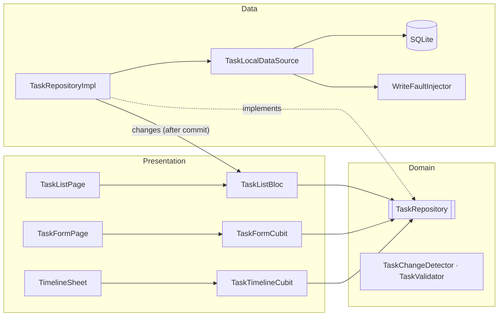

# DESIGN.md

Offline Flutter task manager. Core guarantee: a task change and its activity event are stored together or not at all.

## 1. Architecture & rejected alternative
Feature-first `lib/features/tasks/{domain,data,presentation}` + small `core/`. Dependency rule: `presentation → domain ← data`. Domain is pure Dart (entities, `TaskChangeDetector`, `TaskValidator`, `TaskRepository` interface). Blocs call the repository interface directly.

**Rejected:** Clean Architecture with one UseCase class per operation — each would be a one-line pass-through; real logic already lives in pure domain functions. Also rejected: drift (codegen, hides SQL), Hive/Isar/JSON (no multi-record transaction), optimistic UI (partial UI state), `get_it` (one repo, one DB).

## 2. Data model & atomicity
- `tasks(id TEXT PK uuid, title, description, priority TEXT, is_completed 0/1, created_at UTC ms)`; `task_events(id AUTOINCREMENT, task_id FK ON DELETE CASCADE, type, from_priority, to_priority, occurred_at UTC ms)`. CHECK constraints on enums/booleans; full DDL in `migrations.dart`.
- TEXT enums (safe if enum order changes); UTC millis (no timezone ambiguity); timeline ordered `occurred_at, id` (id breaks same-ms ties).
- **Every write is one `db.transaction`** using only `txn`: read the stored row, decide, update task, insert event, commit. The diff is computed against the **stored row inside the transaction**, not the UI snapshot. No change ⇒ zero statements executed (tested with `total_changes()`).
- `PRAGMA foreign_keys = ON` per connection (`onConfigure`), otherwise cascade is inert.
- **Schema versioning:** `schemaVersion = kMigrations.length`; `onUpgrade` runs the missing steps in order; downgrade throws (never wipes user data).
- Task ids are client-generated UUIDs created when the form opens, so a retry after a failed save cannot create duplicates.

## 3. Blocs/Cubits and the state each owns
| | Owns | Why this type |
|---|---|---|
| `TaskListBloc` | status, tasks, `TaskQuery`, load failure, action failure (message, optional retry event, token) | needs transformers: debounce+`restartable` (search), `sequential` (mutations), subscription to `repo.changes` |
| `TaskFormCubit` | mode, preassigned id, priority, titleError, submit status, failure+token | simple, screen-scoped |
| `TaskTimelineCubit` | status, events, failure | scoped to the bottom sheet |

The list is **always rebuilt from a DB read** (`changes` stream after commit, or an explicit reload after a failure); writes never patch list state.

## 4. Failures
- `FAIL_WRITES=true` (all writes fail) and `FAIL_FIRST_WRITES=N` (first N write operations fail, then recover). The fault fires **mid-transaction** (after the task write, before commit), proving rollback; no partial row or event survives (tests assert both tables).
- Raw exceptions never leave `data/`: repository returns `Result` with friendly `StorageFailure` messages (details are logged).
- On failure the bloc sets an `ActionFailure` (incrementing token so identical errors re-trigger the listener) and reloads, so the UI shows the stored state plus an error with **Retry**. The form stays open with the user's input.

## 5. Concurrency
- Complete/reopen sends a **target** (`setCompleted(id, bool)`); inside the transaction an already-matching state is a no-op with no event ⇒ never two `Completed` or two `Reopened` in a row, even for concurrent callers (tested: 10 parallel calls → 1 event). Mutations also run `sequential()`.
- Search: 300 ms debounce + `restartable()`. `restartable` only drops emits (the DB call continues), so each handler also checks `state.query == its query` before emitting — this also covers stale results across *different* event types.

## 6. Deleting a task
Hard delete; events are removed by `ON DELETE CASCADE` in the same transaction (history belongs to the task; no orphans). Trade-off: no audit trail/undo. Soft delete would be needed for sync (see §7).

## 7. Server sync (design only)
Migration v2: `tasks` gets `updated_at`, `revision`, `deleted_at` (tombstone); `task_events` gets a `uuid` for idempotent merge; new `outbox(id, entity, entity_id, op, payload, created_at)`. The outbox row is written **in the same transaction** as the task and event (transactional outbox), so local state and pending sync can't diverge. A sync worker drains the outbox oldest-first, idempotent via client UUIDs. Conflicts: field-level last-writer-wins by `updated_at`/`revision` for tasks; events are append-only and unioned by uuid; completion state is derived from the latest completed/reopened event. Pulled remote changes are applied through the same transactional local write path, which emits `changes`, so the UI refreshes unchanged.

## Known limitations
List tiles rebuild when `tasks` changes (negligible: `ListView.builder`, visible rows only); clear-filters dispatches several debounced/immediate events (the `state.query` guard keeps it correct); ASCII-only case-insensitive search; ordering depends on the device clock; no pagination or delete-undo; web unsupported.
