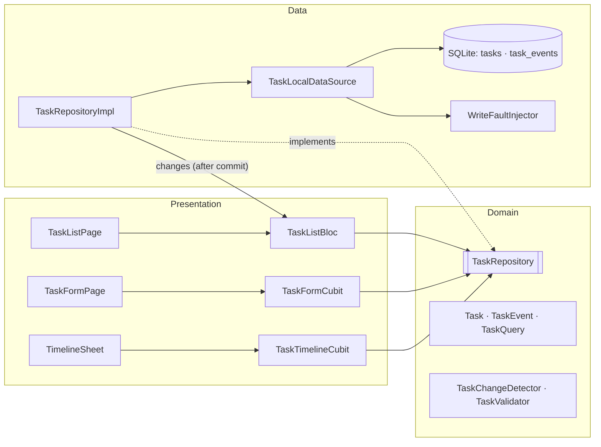

# PLAN.md — Offline Task Manager (Flutter) · Phased Implementation Plan

> **Hard time box: 3 hours.** The reviewers grade *decisions, structure, and how the AI is directed and verified* — not feature count.
> A smaller solution with strong engineering beats a large one with weak reasoning. If time runs short, **cut features, never engineering** (see §8).

---

## 1. Agent handoff protocol (READ FIRST — applies to every agent/tool)

This file + `git log` are the only source of truth. Any agent can resume at any point:

1. Read `CLAUDE.md` (rules), this file, then run `git log --oneline` and `git status`.
2. Find the **first unchecked phase** in §5 (Progress tracker). Execute **only that phase**. If the working tree is dirty, read `git diff`, finish the remaining checklist items of that phase — do not redo finished work.
3. Phase is done only when: every step is done, `flutter analyze` has **zero** issues, `flutter test` is green.
4. Tick the phase in §5, then create the commit **with the exact message given** at the end of the phase (the tracker tick goes into that commit).
5. Never squash, amend, or rebase earlier phase commits (the assignment requires real history). Keep any `Co-Authored-By` trailer your tool adds — it documents AI involvement.
6. **Log real AI mistakes** in `AI_WORKFLOW.md → Running log` the moment they happen (what the AI did, how it was caught, fix commit). Never invent entries.
7. Do not add features not in this plan. If something is ambiguous, ask the human instead of guessing.

Suggested prompt per phase: *"Read CLAUDE.md and PLAN.md. Execute Phase N only, following its steps exactly, then stop."* — save the prompts you actually use; they go into `AI_WORKFLOW.md`.

---

## 2. Requirements digest → traceability

| # | Requirement (from the assignment) | Implemented in | Proven by |
|---|---|---|---|
| R1 | Task list: search by title; filter by priority + completion (combined) | P3 (SQL query), P4 (bloc), P6 (UI) | P3 filter tests, P4 bloc tests |
| R2 | Complete / reopen / delete | P3, P4, P6 | P3, P4, P7 |
| R3 | Timeline bottom sheet, chronological, with timestamps | P3 (query), P5 (cubit), P6 | P3 ordering test |
| R4 | One create/edit form, title required, save & return | P5, P6 | P5 cubit tests |
| R5 | Events: created / priority old→new / completed / reopened | P1 (detector), P3 | P1, P3 tests |
| R6 | List auto-updates after any change, keeps search + filters | P3 (`changes` stream), P4 | P4 tests |
| R7 | Data survives restart; versioned schema | P2, P3 | P2 migration test, P7 manual |
| R8 | Task change + activity atomic; no-op save writes nothing | P3 | P3 rollback + `total_changes()` tests |
| R9 | BLoC/Cubit; UI/logic separated; loading/empty/success/error; no needless rebuilds; dispose | P4–P6 | review checklist P6 |
| R10 | Reproducible write failures (`--dart-define=FAIL_WRITES=true`); nothing partial; UI shows stored state + error + retry | P2, P3, P4, P6 | P3 rollback, P4 retry, P7 manual |
| R11 | Rapid complete/reopen never double-event; fast typing never shows older query | P3 (idempotent txn), P4 (transformers) | P3 concurrency, P4 stale-query tests |
| R12 | A few focused tests on riskiest logic | P1, P3, P4, P5, P7 | `flutter test` |
| R13 | Deliverables: README, DESIGN.md, AI_WORKFLOW.md, diagram, CLAUDE.md, real history | P0, P8, P9 | P9 gate |

---

## 3. Decision log (single source for DESIGN.md — keep the rejected alternatives!)

| Topic | Chosen | Rejected alternative & why |
|---|---|---|
| Layering | Feature-first (`features/tasks/{domain,data,presentation}`) + small `core/`. Blocs call a `TaskRepository` interface directly. Real domain logic = pure functions (`TaskChangeDetector`, `TaskValidator`). | **Full Clean Architecture with a UseCase class per operation**: each would be a one-line pass-through to the repository → ceremony without value in a 3h/2-screen app. |
| State mgmt | **1 `TaskListBloc`** (needs event transformers: debounce, restartable, sequential) + **2 Cubits** (`TaskFormCubit`, `TaskTimelineCubit`) scoped to their screens. | One global Cubit: mixes list/form/timeline state → rebuilds + no per-concern concurrency policy. |
| Persistence | **`sqflite`** (raw SQL, explicit `db.transaction`, `PRAGMA`-level control, `version`/`onUpgrade`). | **drift**: great, but codegen + hidden SQL cost time and obscure the atomicity story. **Hive/Isar/shared_prefs-JSON**: no real multi-record transaction → can't guarantee task+event atomicity. |
| Atomicity | Every write = one `db.transaction`; task row + event row(s) inside the same `txn`. Diff is computed **inside** the txn against the *stored* row. | Computing diff from the UI snapshot (stale) / two separate writes. |
| List refresh | **Pull after write**: repository emits `changes` after a committed write → bloc re-queries with the *current* query. Failures also trigger a re-query (UI always shows stored state). | **Optimistic UI + rollback**: partial UI state, hard to prove consistency. **Reactive DB streams (drift `watch`)**: hides when/why a refresh happens. |
| Search/filter | In SQL (`LIKE … ESCAPE '\'`, `AND` of filters). Makes the stale-result race real → and solved. | In-memory filtering: simpler but doesn't scale and the race wouldn't exist (dodging the requirement). |
| Complete/reopen | Command carries **target** (`setCompleted(id, true)`), repository is **idempotent inside the txn** (already in target state → no write, no event). Bloc runs mutations `sequential()`. | `toggle(id)`: N rapid taps ⇒ N alternating events (valid but surprising). `droppable()`: loses taps silently. |
| Delete | **Hard delete + `ON DELETE CASCADE`** of events, in one txn. History belongs to the task; nothing in the UI can show orphans. | Soft delete/tombstone now: YAGNI offline; described for sync in DESIGN.md. |
| IDs | Task id = client-generated **UUID v4** (`uuid`), created when the form opens → retry after a failed save reuses the same id (no duplicates); sync-friendly. Event id = local `INTEGER AUTOINCREMENT` (ordering tie-break). | Autoincrement int for tasks (collides across devices on future sync). |
| Time | Stored as UTC epoch **milliseconds** (INTEGER). Injected `Now` function for deterministic tests. Events ordered `occurred_at ASC, id ASC`. | ISO strings (slower compare, timezone ambiguity). |
| Enums in DB | TEXT (`'low'|'medium'|'high'`, event `type` TEXT) + `CHECK` constraints. | INTEGER ordinals (break on enum reorder). |
| DI | Manual: `RepositoryProvider` at root, `BlocProvider` per screen. | `get_it`: one repository + one DB doesn't justify a service locator. |
| Navigation | Plain `Navigator` push/pop. | `go_router`: no deep links needed. |
| Dates in UI | `MaterialLocalizations` formatting (no `intl` dep). | `intl` package: extra dependency for 2 format calls. |
| Form scope | Title, description, priority only. Completed is toggled **only** from the list (single code path for completed/reopened events). | Checkbox in form: second path producing completion events. |

Task title/description are **trimmed**; blank description stored as `''`. Title: required, 1–120 chars after trim.

---

## 4. Target structure

```
lib/
  main.dart                         # platform sqlite init (desktop only), runApp
  app.dart                          # RepositoryProvider<TaskRepository>, MaterialApp
  core/
    config/app_config.dart          # const FAIL_WRITES / FAIL_FIRST_WRITES via bool/int.fromEnvironment
    error/failures.dart             # Failure (Equatable): StorageFailure, NotFoundFailure
    utils/result.dart               # sealed Result<T>: Success / Failed
    theme/app_theme.dart            # (existing)
  features/tasks/
    domain/
      entities/{task,task_event,priority,task_query,task_draft,write_outcome}.dart
      logic/{task_change_detector,task_validator}.dart      # pure Dart, no Flutter/sqflite
      repositories/task_repository.dart                     # abstract interface
    data/
      database/{app_database,migrations}.dart
      fault/write_fault_injector.dart
      models/{task_model,task_event_model}.dart             # Map <-> entity
      datasources/task_local_datasource.dart                # SQL, throws
      repositories/task_repository_impl.dart                # try/catch -> Result, emits `changes`
    presentation/
      list/{bloc/{task_list_bloc,task_list_event,task_list_state}.dart, view/*}
      form/{cubit/{task_form_cubit,task_form_state}.dart, view/*}
      timeline/{cubit/{task_timeline_cubit,task_timeline_state}.dart, view/*}
test/                               # mirrors lib/; fakes in test/support/
```

Dependency rule: `presentation → domain ← data`. `domain` imports nothing from Flutter/sqflite/blocs. Blocs never import `data/`. Widgets never touch the repository.

---

## 5. Progress tracker (tick inside each phase's commit)

| ✔ | Phase | Budget | Commit |
|---|---|---|---|
| [x] | P0 Bootstrap, cleanup, deps, CLAUDE.md | 10 min | 2 commits |
| [ ] | P1 Domain + pure logic + tests | 12 min | 1 |
| [ ] | P2 SQLite schema, migrations, fault injector | 13 min | 1 |
| [ ] | P3 Atomic repository + tests (riskiest) | 22 min | 1 |
| [ ] | P4 TaskListBloc + tests | 22 min | 1 |
| [ ] | P5 Form + Timeline cubits + tests | 12 min | 1 |
| [ ] | P6 UI wiring | 22 min | 1 |
| [ ] | P7 Integration tests + manual verification + fixes | 10 min | 1+ |
| [ ] | P8 Docs: DESIGN, README, AI_WORKFLOW (weights 40% total!) | 45 min | 3 |
| [ ] | P9 Final gate + end time | 12 min | 1 |

Target: code complete by ~T+2h, leaving buffer for docs. **Start time must be recorded in P0.**

---

## 6. Phases

### P0 — Bootstrap, cleanup, deps, CLAUDE.md (10 min)

1. Run `date -Iseconds`; write it as `Started:` in a new `README.md` stub (replace the Flutter default text; use the real start time if the clock started earlier).
2. **Commit 0a** with only this `PLAN.md`.
3. Remove the demo: delete `lib/features/home/**` and `lib/core/usecases/usecase.dart`. In `failures.dart` make `Failure` an `Equatable` (`props: [message]`), keep only `StorageFailure` and `NotFoundFailure` (offline app → no Server/Network failures). In `result.dart` rename `Error<T>` → `Failed<T>` (**`Error` shadows `dart:core`'s `Error`**). In `app.dart` temporarily show `Scaffold(body: Center(child: Text('Niksam')))` so the app compiles. Delete `core/constants/app_constants.dart` only if unused.
4. Dependencies (let pub resolve latest compatible; do not hand-pin):
   `flutter pub add flutter_bloc bloc_concurrency equatable sqflite sqflite_common_ffi path uuid stream_transform`
   `flutter pub add --dev bloc_test mocktail`
5. `analysis_options.yaml`: keep `flutter_lints`; add `analyzer: language: {strict-casts: true, strict-inference: true, strict-raw-types: true}`.
6. **`CLAUDE.md` already exists in the repo** (created together with this plan) — review it, adjust if the plan changed, and include it in commit 0a/0b. Its contents: project one-liner; commands (`flutter pub get`, `flutter analyze`, `flutter test`, `flutter run --dart-define=FAIL_WRITES=true`); the dependency rule + structure from §4; rules below; pointer to `PLAN.md` handoff protocol.
   Rules to include verbatim in spirit: *domain is pure Dart* · *all SQL lives in `data/`* · *every multi-row write is one `db.transaction` and uses the `txn` object only (never `db` inside the callback → deadlock)* · *`PRAGMA foreign_keys = ON` in `onConfigure`* · *States are immutable `Equatable` with complete `props`* · *no `setState` except for controllers/ephemeral UI* · *no business logic in widgets* · *dispose every controller/subscription/stream/db* · *tests for logic, no coverage chase* · *English imperative commit messages, one commit per phase, never rewrite history* · *log AI mistakes in AI_WORKFLOW.md*.
7. Create **`AI_WORKFLOW.md`** skeleton: sections `Tools`, `How I split the work`, `Key prompts`, `Where the AI was wrong`, `What I verified myself`, and a bottom `## Running log` (append-only during development).
8. Create `.vscode/launch.json` with two configs: `Niksam` and `Niksam (FAIL_WRITES)` using `"args": ["--dart-define=FAIL_WRITES=true"]`.
9. `flutter analyze` clean (an empty `test/` is fine for now).

**Commits**
- 0a: `docs: add phased implementation plan`
- 0b: `chore: strip demo scaffold, add dependencies, CLAUDE.md, AI log skeleton and launch configs`

---

### P1 — Domain model + pure logic (12 min)

Pure Dart, no imports from Flutter/sqflite. All classes immutable + `Equatable`.

1. `Priority { low, medium, high }` with a `label`.
2. `Task { id, title, description, priority, isCompleted, createdAt }` + `copyWith`.
3. `sealed class TaskEventKind`: `Created`, `PriorityChanged(from, to)`, `Completed`, `Reopened`. `TaskEvent { int id, String taskId, DateTime at, TaskEventKind kind }`.
4. `TaskDraft { title, description, priority }` with `normalized()` (trim both; blank description → `''`).
5. `CompletionFilter { all, open, completed }`; `TaskQuery { text = '', Priority? priority, completion = all }` + `copyWith` (needs a way to clear `priority` → use a wrapper or `clearPriority` flag), `bool get isActive`.
6. `sealed class WriteOutcome`: `Saved(Task task)` | `Unchanged()`.
7. `TaskRepository` (abstract interface):
   ```dart
   Stream<void> get changes;                                   // after each committed write that changed data
   Future<Result<List<Task>>> getTasks(TaskQuery query);
   Future<Result<List<TaskEvent>>> getTimeline(String taskId);  // chronological
   Future<Result<Task>> create(String id, TaskDraft draft);     // writes task + `created` event
   Future<Result<WriteOutcome>> update(String id, TaskDraft draft);
   Future<Result<WriteOutcome>> setCompleted(String id, bool completed);
   Future<Result<void>> delete(String id);
   Future<void> dispose();
   ```
8. `TaskChangeDetector` (static, pure):
   - `bool hasChanges(Task stored, TaskDraft next)` — compares **normalized** title/description/priority.
   - `List<TaskEventKind> eventsForUpdate(Task stored, TaskDraft next)` — only `PriorityChanged(old→new)` when priority differs; title/description edits produce **no** event.
   - `TaskEventKind? eventForCompletion(Task stored, bool target)` — `Completed` / `Reopened`, or `null` if already in target state (this is the idempotency core).
9. `TaskValidator.validateTitle(String) → TitleError?` (`empty`, `tooLong`) on the trimmed value.
10. **Tests** (`test/features/tasks/domain/`): change detector (priority old→new; title-only → row change but no event; identical and whitespace-only-different → no changes; completion event null when already in state; completed/reopened mapping), validator boundaries (blank, whitespace, 120, 121).

**Done when:** pure-Dart tests green. **Commit:** `feat(tasks): add domain entities, repository contract and change detection`

---

### P2 — SQLite schema, migrations, fault injector (13 min)

1. `migrations.dart`: `typedef Migration = Future<void> Function(DatabaseExecutor db)`; `final List<Migration> kMigrations = [_v1]`; **`schemaVersion = kMigrations.length`** (cannot forget to bump). `_v1` SQL:
   ```sql
   CREATE TABLE tasks(
     id TEXT PRIMARY KEY,
     title TEXT NOT NULL CHECK(length(trim(title)) > 0),
     description TEXT NOT NULL DEFAULT '',
     priority TEXT NOT NULL CHECK(priority IN ('low','medium','high')),
     is_completed INTEGER NOT NULL DEFAULT 0 CHECK(is_completed IN (0,1)),
     created_at INTEGER NOT NULL
   );
   CREATE TABLE task_events(
     id INTEGER PRIMARY KEY AUTOINCREMENT,
     task_id TEXT NOT NULL REFERENCES tasks(id) ON DELETE CASCADE,
     type TEXT NOT NULL CHECK(type IN ('created','priority_changed','completed','reopened')),
     from_priority TEXT, to_priority TEXT,
     occurred_at INTEGER NOT NULL
   );
   CREATE INDEX idx_events_task ON task_events(task_id, occurred_at, id);
   CREATE INDEX idx_tasks_created ON tasks(created_at DESC);
   ```
2. `app_database.dart`: `AppDatabase.open({String? path, DatabaseFactory? factory, List<Migration>? migrations})` →
   `openDatabase(version: schemaVersion, onConfigure: (db) => db.execute('PRAGMA foreign_keys = ON'), onCreate: run migrations 0..n, onUpgrade(old,new): run migrations[old..new-1] inside the open transaction, onDowngrade: throw (never silently wipe user data))`. Expose a **lazy, memoized `Future<Database>`** that resets on failure → open errors surface as `StorageFailure` through the repository (the list shows error + Retry which re-attempts open).
3. `models/`: `TaskModel.fromMap/toMap` (bool↔0/1, Priority↔name, DateTime↔UTC millis) and `TaskEventModel` (kind ↔ `type` + `from_priority`/`to_priority`).
4. `core/config/app_config.dart`:
   ```dart
   static const failWrites = bool.fromEnvironment('FAIL_WRITES');
   static const failFirstWrites = int.fromEnvironment('FAIL_FIRST_WRITES'); // fail first N write ops, then recover
   ```
   (`fromEnvironment` only works as `const`; `--dart-define` changes need a full restart, not hot reload.)
5. `fault/write_fault_injector.dart`:
   ```dart
   abstract interface class WriteFaultInjector {
     void beginWrite();              // once per repository write operation
     void checkpoint(String name);   // throws InjectedWriteException when this op must fail
   }
   ```
   `NoFault`, `ConfiguredFault` (from `AppConfig`; `FAIL_WRITES` = always; `FAIL_FIRST_WRITES=N` = first N ops fail → makes **Retry demonstrable without code changes**), and a test-friendly fake (fail at a named checkpoint). `InjectedWriteException implements Exception`.
6. **Tests:** fresh open → `PRAGMA user_version == schemaVersion`; `PRAGMA foreign_keys` returns 1; upgrade chain using an injected extra migration list (v0→v2 applies both, in order); CHECK constraints reject invalid priority. Use `sqflite_common_ffi` with `inMemoryDatabasePath` and `singleInstance: false` for isolation. **Verify `flutter test` loads libsqlite3 on this machine now** (`sudo apt install libsqlite3-dev` if not).

**Commit:** `feat(data): add versioned SQLite schema, migrations and write fault injection`

---

### P3 — Atomic repository (the riskiest part) (22 min)

`TaskLocalDataSource` (SQL, throws) + `TaskRepositoryImpl` (try/catch → `Result`, owns `changes` `StreamController<void>.broadcast()`, injected `Now`).

**Write algorithm (same shape for every write):**
```
fault.beginWrite();
final now = _now();                                   // captured once; used for row AND event
final outcome = await db.transaction((txn) async {
  stored = read row via txn (throw NotFound if missing)
  decide via TaskChangeDetector against *stored*      // not the UI snapshot
  if (nothing to do) return Unchanged;                // no statement executed → "writes nothing"
  await txn.update/insert/delete(...);   fault.checkpoint('after_task_write');
  await txn.insert('task_events', ...);  fault.checkpoint('before_commit');
  return Saved(updatedTask);
});
if (outcome is Saved) _changes.add(null);             // only AFTER commit, only if something changed
```
Operations:
- `create(id, draft)`: normalize + insert task (`created_at = now`) + `Created` event (`occurred_at = now`).
- `update(id, draft)`: diff vs stored; no changes → `Unchanged`; else update row (+ `PriorityChanged(old→new)` event only if priority differs).
- `setCompleted(id, target)`: `eventForCompletion` null → `Unchanged` (**idempotent: concurrent duplicates become no-ops**); else update flag + `Completed`/`Reopened` event.
- `delete(id)`: delete task; events removed by `ON DELETE CASCADE` (FK pragma from P2); `NotFound` if missing.
- `getTasks(query)`: dynamic `WHERE` (title `LIKE ? ESCAPE '\'` with `\`, `%`, `_` escaped in user text; `priority = ?`; `is_completed = ?`) `ORDER BY created_at DESC, id DESC`.
- `getTimeline(taskId)`: `ORDER BY occurred_at ASC, id ASC`.
- Error mapping: `NotFoundException` → `NotFoundFailure`; any other exception (incl. `InjectedWriteException`, `DatabaseException`) → `StorageFailure('…')`. Raw exceptions never leave the repository.
- `dispose()`: close `changes` controller and the database.

**Tests** (`test/features/tasks/data/`, real in-memory SQLite, fixed `Now`, fake fault injector):
1. **Rollback:** fault at `after_task_write` for create / update-with-priority-change / setCompleted / delete → afterwards DB identical to before (no task change, no event), result is `Failed(StorageFailure)`, `changes` did not emit.
2. **No-op writes nothing:** `update` with identical (and whitespace-different) draft → `Unchanged`; `SELECT total_changes()` unchanged; zero events added; `beginWrite` may be counted but no checkpoint reached; `changes` silent.
3. **Idempotent concurrency:** `Future.wait` of 10 × `setCompleted(id, true)` → exactly **1** `Completed` event. Mixed concurrent `true,false,true,false…` → event kinds strictly alternate (never two equal in a row).
4. **Events:** create → exactly `[Created]`; priority Low→High → `PriorityChanged(low→high)`; title-only edit → task updated, **no** event.
5. **Delete cascade:** after delete, `SELECT COUNT(*) FROM task_events WHERE task_id=?` is 0 (proves FK pragma is really on).
6. **Query:** search + priority + completion combined; `%` and `_` in search treated literally; ordering newest first; timeline chronological with same-millisecond tie-break by id.

**Commit:** `feat(data): implement atomic task repository with rollback, idempotent completion and tests`

---

### P4 — TaskListBloc (22 min)

**Events** (sealed): `TaskListStarted`, `TaskListSearchChanged(text)`, `TaskListPriorityChanged(Priority?)`, `TaskListCompletionChanged(CompletionFilter)`, `TaskListReloadRequested`, sealed `TaskMutationRequested` → `TaskCompletionSetRequested(id, completed)` / `TaskDeleteRequested(id)`, `TaskActionFailureDismissed`.

**State** (Equatable, all fields in `props`): `status {loading, success, failure}`, `List<Task> tasks`, `TaskQuery query`, `Failure? loadFailure`, `ActionFailure? actionFailure`.
`ActionFailure { String message, TaskListEvent retryEvent, int token }` — the **token (incrementing counter) is mandatory**: otherwise two identical consecutive failures are `==` and `BlocListener` never fires again.
"Empty" is derived: `success && tasks.isEmpty` → UI distinguishes *no tasks yet* (`!query.isActive`) from *no matches* (`query.isActive`).

**Handlers & transformers**
- `SearchChanged`: transformer = `events.debounce(300ms)` **then** `restartable()`; others that change the query: `restartable()`. Shared handler body `_applyQuery(next, emit)`:
  1. `emit(state.copyWith(query: next, status: tasks nonEmpty ? success : loading))` — **the state's query is the source of truth**;
  2. `final r = await repo.getTasks(next);`
  3. `if (emit.isDone || state.query != next) return;` ← drops stale results even *across* different event types (restartable only protects within one type, and it does **not** cancel the DB call, it only drops emits);
  4. emit success/failure.
- `TaskListStarted` / `ReloadRequested`: same load with the current query (restartable).
- `TaskMutationRequested`: one `on<TaskMutationRequested>` registered with **`sequential()`** (covers both subtypes → one shared queue). Call repo; `Success` → clear `actionFailure` (list refresh arrives via `changes`); `Failed` → `emit(actionFailure: ActionFailure(msg, retryEvent: event, token: ++_token))` **and** `add(ReloadRequested())` so the UI shows the stored state. `NotFoundFailure` → message "Task no longer exists" + reload.
- Constructor subscribes `repo.changes.listen((_) => add(const TaskListReloadRequested()))`; **override `close()` to cancel the subscription** (await `super.close()`).
- The list is **always** rebuilt from a DB read; writes never mutate `tasks` in state directly.

**Tests** (`bloc_test`, hand-written `FakeTaskRepository` with `Completer`-controlled latency, not `Timer`s, for determinism):
1. **Stale query:** search "a" (slow, completer A) then "ab" (fast) → "ab" results emitted; complete A afterwards → state unchanged (still "ab" results).
2. **Cross-type staleness:** search change in flight, then priority filter change → final state holds both filters and the newest results.
3. **Debounce:** 5 rapid `SearchChanged` within 300 ms → repo `getTasks` called once with the last text.
4. **Rapid same-target taps:** 5 × `TaskCompletionSetRequested(id, true)` → processed in order, one at a time (`max concurrent == 1` in the fake).
5. **Failure path:** repo returns `Failed` → `actionFailure` set with a retry event, a reload is requested, `tasks` equal stored state; add the `retryEvent` → repo called again; second identical failure produces a *different token*.
6. **Changes stream:** a `changes` emission triggers a reload with the current (non-default) query; `close()` cancels the subscription (no events after close).
7. Initial load failure → `status: failure` + `Reload` recovers.

**Commit:** `feat(list): add TaskListBloc with debounced restartable search and sequential mutations`

---

### P5 — Form + Timeline cubits (12 min)

**`TaskFormCubit(repo, {Task? original})`** — owns: `mode`, `priority` draft, `titleError`, `status {editing, submitting, success, failure}`, `failure`/`token`, and the **preassigned `taskId`** (`original?.id ?? uuid.v4()` — created at construction so Retry never duplicates).
- `priorityChanged(p)`; `titleEdited()` clears `titleError` only if one is set (avoid needless emits).
- `submit(title, description)`: ignore if `status == submitting` (double-tap guard); validate via `TaskValidator` → `titleError` and stop; `emit(submitting)`; call `repo.create(id, draft)` or `repo.update(id, draft)`; `Success` (incl. `Unchanged`) → `status: success` (page pops; **no-change save writes nothing** — enforced by the repo); `Failed` → `status: failure` with message + token — the form **stays open with the user's input intact**; pressing Save/Retry calls `submit` again.
- Text lives in `TextEditingController`s owned (and disposed) by the page; the cubit holds no `BuildContext`.

**`TaskTimelineCubit(repo, taskId)`** — owns `status {loading, success, failure}` + `List<TaskEvent> events`; `load()`; retry = `load()`. Created in the bottom sheet's `BlocProvider` (auto-closed).

**Tests** (`bloc_test`): empty/whitespace title → `titleError`, repo never called; valid create → repo called with the *same* id on retry after failure; double `submit` while submitting → one repo call; edit with no change → success, no write (fake returns `Unchanged`); failure keeps state recoverable; timeline success/empty/failure + retry.

**Commit:** `feat(form): add TaskFormCubit and TaskTimelineCubit with tests`

---

### P6 — UI wiring (22 min) — functional, not pretty

- `main.dart`: `WidgetsFlutterBinding.ensureInitialized()`; on Linux/Windows/macOS only (`!kIsWeb && Platform.is…`) call `sqfliteFfiInit(); databaseFactory = databaseFactoryFfi;`. Do **not** block startup on DB open (lazy open from P2).
- `app.dart`: `RepositoryProvider<TaskRepository>` creating `TaskRepositoryImpl(TaskLocalDataSource(AppDatabase…, ConfiguredFault()))` and **disposing it** (use `RepositoryProvider`'s `dispose` callback if the resolved `flutter_bloc` version has it; otherwise hold the repo in a `StatefulWidget` and dispose in `State.dispose`).
- **List page:** `BlocProvider(create: TaskListBloc(repo)..add(TaskListStarted()))`.
  - `SearchField` (StatefulWidget owning/disposing its `TextEditingController`; `onChanged` → `SearchChanged`; **does not rebuild on state**).
  - `FilterBar` using `BlocSelector<…, ({Priority? p, CompletionFilter c})>` (records have value equality) → priority chips (All/Low/Med/High) + completion segmented (All/Open/Done).
  - Body `BlocBuilder` with `buildWhen: status/tasks/loadFailure/query.isActive` only. States: **loading** spinner · **failure** message + Retry (`ReloadRequested`) · **empty** (two variants, "Clear filters" on no-match) · **success** `ListView.builder` with `ValueKey(task.id)`.
  - `TaskTile` is a dumb widget: `Task` + callbacks (`onTap`→timeline sheet, `onToggle`→`TaskCompletionSetRequested(task.id, !task.isCompleted)`, menu Edit/Delete). Delete asks for confirmation (`showDialog`) then dispatches `TaskDeleteRequested`.
  - `BlocListener` (`listenWhen: actionFailure changed && non-null`) shows a `SnackBar` with the message and a **Retry** action dispatching `failure.retryEvent`.
  - FAB → push form (create). Tile menu Edit → push form (edit, passes the `Task`).
- **Form page:** `BlocProvider(create: TaskFormCubit(repo, original: …))`; title field `errorText` from state; priority `SegmentedButton`; Save button disabled while submitting; `BlocListener`: `success` → `Navigator.pop`; `failure` → SnackBar with Retry (calls the same submit). Controllers disposed.
- **Timeline sheet:** `showModalBottomSheet` + `BlocProvider(create: TaskTimelineCubit(repo, task.id)..load())`; rows = icon + text (`Created` / `Priority: Low → High` / `Completed` / `Reopened`) + date-time via `MaterialLocalizations`; loading / empty / failure+Retry states.
- **Checklist before commit:** no logic in widgets · every `TextEditingController`/`FocusNode` disposed · no `setState` for business state · `const` constructors · `flutter analyze` clean · one widget smoke test (app boots with fake repo and shows empty state) — drop it first if short on time.

**Commit:** `feat(ui): add task list, form and timeline screens wired to blocs`

---

### P7 — Integration tests + manual verification (10 min)

1. **Integration-style tests** (real in-memory SQLite + real `TaskRepositoryImpl` + real `TaskListBloc`, no mocks):
   - 10 rapid `TaskCompletionSetRequested(id, true)` → timeline has exactly one `Completed`.
   - Fault injector always failing: complete/delete/create → list state equals stored state, `actionFailure` set; swap injector to `NoFault` (or `FAIL_FIRST_WRITES` semantics), dispatch `retryEvent` → succeeds, exactly one event written.
2. **Manual checklist** (run on a real target; note any deviation in README "Limitations"):
   - [ ] Create/edit/complete/reopen/delete; kill app + relaunch → data and timeline persist.
   - [ ] Type fast in search; combine priority + completion filters; edit a task while filtered → filters/search preserved after save.
   - [ ] `flutter run --dart-define=FAIL_WRITES=true`: every write shows error, list unchanged; relaunch **without** the flag → no partial data (no orphan/half-written rows).
   - [ ] `--dart-define=FAIL_FIRST_WRITES=1`: first action fails, Retry succeeds, exactly one event.
   - [ ] Tap Complete ×10 very fast → one `Completed` event; Complete→Reopen alternation correct.
   - [ ] Save edit with no changes → no new events, no refresh flicker.
3. Fix any bug found as separate `fix:` commits (message describes the bug). Log any AI-caused bug in `AI_WORKFLOW.md`.

**Commit:** `test: add repository+bloc integration tests for failure and rapid-tap scenarios`

---

### P8 — Documentation (45 min; DESIGN + AI_WORKFLOW = 40% of the grade)

**8a — `DESIGN.md` (1–2 pages, tight).** Condense §3. Sections (use exactly these):
1. **Architecture & rejected alternative** — layers, dependency rule, *why no UseCase classes*; embed the Mermaid diagram below (also saved as `docs/architecture.md` or inline).
2. **Data model & atomicity** — both tables, constraints, why TEXT enums/UTC millis, `PRAGMA foreign_keys`, one `db.transaction` per write, diff against stored row inside txn, no-op = zero statements, schema versioning (`kMigrations.length`, `onUpgrade`, no destructive downgrade).
3. **Blocs/Cubits & the state each owns** — table: `TaskListBloc` (tasks, query, status, load/action failures), `TaskFormCubit` (draft priority, titleError, submit status, preassigned id), `TaskTimelineCubit` (events, status); why list is Bloc and the others Cubits.
4. **Failures** — fault injection (`FAIL_WRITES`, `FAIL_FIRST_WRITES`, mid-transaction checkpoint → rollback proof), `Result` boundary, UI re-reads stored state, retry event + token.
5. **Concurrency** — idempotent `setCompleted` (DB-level invariant) + `sequential()` (ordering), debounce + `restartable()` + `state.query` guard (what restartable does *not* do), sqflite serializes transactions on one connection.
6. **Deleting a task & its history** — hard delete + cascade in one txn, rationale, trade-off (no audit trail) vs soft delete.
7. **Server sync (design only)** — migration v2: add `updated_at`, `revision`, `deleted_at` (tombstone) to `tasks`; `uuid` to `task_events` (idempotent merge); new `outbox(id, entity, entity_id, op, payload, created_at)` table **written inside the same transaction** as task+event (transactional outbox → still atomic); a sync worker drains outbox oldest-first, idempotent via client UUIDs; tasks: field-level last-writer-wins by `updated_at`/`revision`; events: append-only, union by uuid; completed state derived from the latest completed/reopened event; repository interface unchanged — add a `SyncService` beside it; the `changes` stream already drives UI refresh after pulls.

Mermaid draft (refine to match the final code):

Also add a short Mermaid `sequenceDiagram` of one atomic write (Bloc → Repo → txn: read, update, checkpoint, insert event, commit → `changes` → reload).

**8b — `README.md`:** what it is; setup (Flutter 3.44.x / Dart ^3.12, `flutter pub get`, `flutter run`, `flutter test`, run with `--dart-define=FAIL_WRITES=true` / `FAIL_FIRST_WRITES=1`, desktop note: sqflite FFI initialised on Linux/Windows/macOS; **web unsupported**); packages table with *why* (`flutter_bloc`, `bloc_concurrency`, `stream_transform` (debounce), `equatable`, `sqflite` (+ `sqflite_common_ffi` desktop/tests), `path`, `uuid`; dev: `bloc_test`, `mocktail`); links to DESIGN.md / AI_WORKFLOW.md / CLAUDE.md / diagram; **Limitations & unfinished** (honest list: LIKE is case-insensitive for ASCII only, no pagination, ordering depends on device clock, UI unpolished, no undo for delete, web unsupported, anything cut); **Started / Finished** timestamps.

**8c — `AI_WORKFLOW.md` (1 page):** Tools (Claude Code in VS Code; model name); How the work was split (plan-first: assignment → PLAN.md; one phase per prompt; riskiest logic = pure functions + tests first; human review gate per phase: diff read, analyze, tests); Key prompts (3–5 real ones, quoted); **2–3 places the AI was wrong** — copy only *real* entries from the Running log (prompt → wrong output → how caught → fix commit); What I verified myself (manual checklist from P7, inspected DB state after forced failure, read the transaction code line by line, ran with the flags). Trim the running log to one page.

**Commits**
- 8a: `docs: add DESIGN.md with architecture and sequence diagrams`
- 8b: `docs: add README with setup, packages, limitations and timing`
- 8c: `docs: finalize AI_WORKFLOW.md`

---

### P9 — Final gate (12 min)

1. `flutter analyze` → 0 issues; `flutter test` → green; app launches normally and with `FAIL_WRITES=true`.
2. `git log --oneline` shows ≥ 10 meaningful commits, no squash; `CLAUDE.md`, `PLAN.md`, `AI_WORKFLOW.md`, `DESIGN.md`, `README.md` present; no build artifacts / `.idea` committed (check `.gitignore`).
3. README: fill **Finished:** (`date -Iseconds`); confirm total ≤ 3 h; list anything unfinished.
4. Push to the remote and send the repository link. Prepare for the live session: be able to explain every box in §3 and to make a small change (e.g., add a "clear filters" action or a new event type) with the AI tools.

**Commit:** `chore: final polish and end-time stamp`

---

## 7. Review traps (verify explicitly; log in AI_WORKFLOW.md only if actually hit)

1. `ON DELETE CASCADE` is inert unless `PRAGMA foreign_keys = ON` is set **per connection** (`onConfigure`).
2. Using `db` (not `txn`) inside `db.transaction` → deadlock; writes done outside the txn → atomicity lost.
3. `restartable()` drops emits, it does not cancel the in-flight DB call; staleness across *different* event types needs the `state.query != next` guard.
4. Equatable `props` missing a field → missing rebuilds; identical consecutive `ActionFailure`s need the token.
5. `emit` after handler completion/cancel (`emit.isDone`), subscriptions/controllers not closed in `close()`/`dispose()`.
6. Change detection against the UI snapshot instead of the stored row; no-op check missing normalization (trim).
7. Unescaped `%`/`_` in `LIKE`; `Error` class name shadowing `dart:core`.
8. Fault injected *before* any statement proves nothing — it must fire **mid-transaction** (after the task write, before the event write/commit).
9. `bool.fromEnvironment` used without `const` silently returns the default; flag changes need a full restart.
10. Tests that pass only because the fake repo hides the race — keep one real-SQLite concurrency test (P3/P7).

## 8. Cut list (if time runs short, cut in this order — never the engineering)

1. UI polish, colors, animations. 2. Widget smoke test. 3. Delete confirmation dialog. 4. `FAIL_FIRST_WRITES` (keep plain `FAIL_WRITES`). 5. Mermaid sequence diagram. 6. Cross-type-staleness test (keep the stale-query + rollback + concurrency tests). **Never cut:** transactional writes, rollback test, idempotent completion, stale-query guard, DESIGN.md, AI_WORKFLOW.md, README timing.

## 9. Assumptions (change here first if wrong)

- Persistence = `sqflite`; target device = Android/iOS (desktop supported via FFI init in `main.dart`).
- Docs and code in English (the reviewers' language); chat with the human may be in Persian.
- Form has no "completed" field; completed/reopened events come only from list actions.
- Title ≤ 120 chars; list sorted newest-first; search is a case-insensitive substring match on title only.
